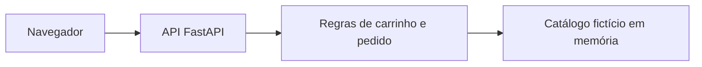

# Definição do projeto

## Nome e descrição

Loja de Estudos DevOps é uma loja didática de materiais de estudo. A interface web
consulta uma API Python, calcula um carrinho e cria pedidos simulados.

## Objetivos

Aplicar colaboração e responsabilidade compartilhada, reduzir trabalho manual com CI,
produzir alterações pequenas e rastreáveis e obter retorno rápido de testes.
O uso de lotes pequenos e automação reduz espera e retrabalho, em linha com Lean;
um backlog curto e entregas incrementais permitem feedback e adaptação, em linha com Agile.

## Funcionalidades da primeira versão

Catálogo de três produtos fictícios, consulta de produto, carrinho com quantidades,
total exato em centavos, validação de estoque demonstrativo e pedido simulado.
Não há cadastro, login, cartão, endereço, banco de dados, pagamento nem persistência.

## Papéis e responsabilidades

| Papel | Responsabilidade prevista |
|---|---|
| Desenvolvimento | Código, validação de entradas e correções. |
| Qualidade | Cenários, testes, cobertura e revisão de critérios de aceite. |
| Operações | Ambiente reproduzível, pipeline, build e validação do pacote. |
| Equipe em conjunto | Revisão do PR, análise das falhas e documentação. |

A composição da equipe não foi informada. Associar os papéis aos integrantes no
relatório privado de entrega, se houver equipe; em trabalho individual, registrar
que o estudante exerceu os papéis. Não inventar participação ou revisão de terceiros.

## Backlog inicial

| ID | História e aceite | Situação |
|---|---|---|
| US01 | Consultar catálogo fictício com nome, preço e estoque. | Implementação local |
| US02 | Montar carrinho com total em centavos e agrupar produtos repetidos. | Implementação local |
| US03 | Recusar quantidade inválida, produto ausente e estoque excedido. | Implementação local |
| US04 | Criar pedido simulado com identificador único e sem cobrança. | Implementação local |
| US05 | Executar testes e interromper CI diante de falhas ou cobertura baixa. | Configuração local; execução no GitHub pendente |
| US06 | Gerar e validar wheel versionado. | Implementação local |
| US07 | Revisar e integrar a funcionalidade por PR. | GitHub pendente |
| US08 | Evoluir para Docker e as Práticas 3 a 6. | Etapas posteriores |

## Arquitetura inicial

As regras não dependem de rede nem arquivos de clientes. A API é sem estado de pedidos;
reiniciar a aplicação não recupera compras, pois elas são apenas simulações.
